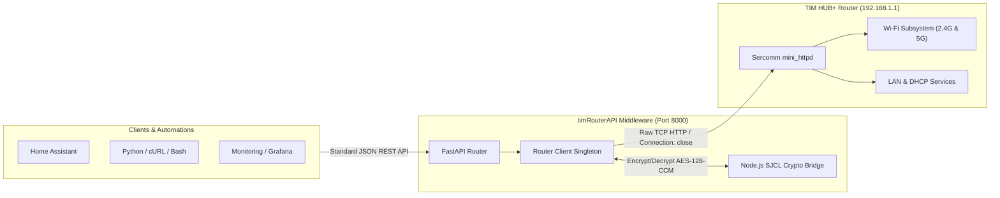

# TIM HUB+ Middleware REST API (`timRouterAPI`)


A high-performance Python REST API middleware for the **TIM HUB+ (Sercomm AGSGP / AGCOMBO, firmware AGSGP_1.0.9)** fiber router.

This service acts as an abstraction bridge between your local network clients (smart home servers, Home Assistant, scripts, monitoring dashboards) and the router's internal Sercomm web service. It handles session lifecycle management, dynamic CSRF token refresh, and Stanford Javascript Crypto Library (SJCL) AES-128-CCM encryption/decryption transparently.

---

## Architecture Overview



---

## Features

- **Transparent Authentication**: Automatically completes the 5-step Sercomm handshake (CSRF token extraction, double HMAC-SHA256 password calculation, session ID tracking).
- **Embedded SJCL Crypto Engine**: Uses the router's native `sjcl.js` runtime to encrypt and decrypt sensitive configuration endpoints (such as `wifi_general.json`) with 100% fidelity.
- **Wi-Fi Subsystem Management**:
  - Full status of 2.4 GHz and 5 GHz radios.
  - Channel switching, bandwidth adjustments, and SSID/password updates.
  - One-click toggle for Band Steering (BSD).
  - Isolated Guest network activation and configuration.
  - Soft radio driver restarts (`/api/v1/wifi/restart`).
- **LAN & DHCP Configuration**:
  - Subnet IP, netmask, lease durations, and DNS servers.
  - Query, create, and delete static DHCP IP reservations by MAC.
- **WAN & Port Forwarding**:
  - WAN IPv4 and IPv6 detection, gateway, and upstream DNS servers.
  - DMZ host activation and IP assignment.
  - UPnP management.
  - IPv4 port forwarding virtual server rules.
- **Real-Time Device Topology**:
  - Complete list of connected devices.
  - Merges DHCP leases, live ARP tables, and wireless station metrics (link speed in Mbps, Wi-Fi RSSI in dBm).
- **System Administration**:
  - Hardware model and capabilities inspection.
  - Automated router reboot and WAN PPPoE reconnection.
- **Interactive Documentation**: Built-in Swagger UI and ReDoc.
- **Container Ready**: Includes production `Dockerfile` and `docker-compose.yml`.

---

## Directory Structure

```
timRouterAPI/
├── assets/
│   ├── sjcl.js               # Stanford Javascript Crypto Library from router
│   └── crypto_bridge.js       # CLI bridge for key derivation and AES-CCM
├── core/
│   ├── config.py             # Pydantic environment configuration
│   ├── crypto.py             # HMAC and Node.js bridge wrapper
│   ├── exceptions.py         # Custom router exception hierarchy
│   └── router_client.py      # Low-level raw socket HTTP client & session manager
├── docs/
│   ├── API_DOCUMENTATION.md  # Complete endpoint schema and usage reference
│   └── ROUTER_PROTOCOL.md    # Reverse-engineering notes and protocol specifications
├── models/
│   ├── auth.py               # Pydantic models for authentication
│   ├── devices.py            # Connected device models
│   ├── lan.py                # LAN & DHCP models
│   ├── system.py             # System info & generic response models
│   ├── wan.py                # WAN, DMZ, and port-forwarding models
│   └── wifi.py               # Wi-Fi radios & settings models
├── routers/
│   ├── auth.py               # /api/v1/auth routes
│   ├── devices.py            # /api/v1/devices routes
│   ├── lan.py                # /api/v1/lan routes
│   ├── system.py             # /api/v1/system routes
│   ├── wan.py                # /api/v1/wan routes
│   └── wifi.py               # /api/v1/wifi routes
├── .env.example              # Example environment variables
├── docker-compose.yml        # Docker compose specification
├── Dockerfile                # Production multi-stage Docker image
├── main.py                   # FastAPI application entrypoint
├── requirements.txt          # Python dependencies
├── test_api.py               # Test suite for client, crypto, and router
└── README.md                 # Project documentation
```

---

## Getting Started

### Prerequisites

1. **Python 3.10+**
2. **Node.js** (v16+, required for running `assets/crypto_bridge.js`)

### 1. Installation

Clone or navigate to the repository directory:
```bash
cd /Users/gianluca/Desktop/personalProjects/timRouterAPI
```

Install the Python dependencies:
```bash
pip install -r requirements.txt
```

### 2. Configuration

Create your `.env` file from the provided template:
```bash
cp .env.example .env
```

Edit `.env` with your router credentials:
```ini
ROUTER_HOST=192.168.1.1
ROUTER_USERNAME=admin
ROUTER_PASSWORD=your_router_password
API_HOST=0.0.0.0
API_PORT=8000
AUTO_LOGIN_ON_STARTUP=true
```

### 3. Run the Server

Start the API server using Uvicorn:
```bash
uvicorn main:app --host 0.0.0.0 --port 8000 --reload
```

The API will now be accessible at:
- **API Base**: `http://localhost:8000/api/v1`
- **Swagger Documentation**: `http://localhost:8000/docs`
- **ReDoc Documentation**: `http://localhost:8000/redoc`

---

## Running with Docker

Run the entire application in a container with a single command:

```bash
docker compose up -d --build
```

To view logs:
```bash
docker compose logs -f
```

To stop the service:
```bash
docker compose down
```

---

## Running the Test Suite

A comprehensive test suite verifies cryptographic key derivation, AES-CCM encrypt/decrypt roundtrips, and live communication with the router:

```bash
python3 test_api.py
```

Expected output:
```
--- Connecting and authenticating with router ---
Logged in successfully! Session ID: pyumlhjyQNzINPLQ... FW: AGSGP_1.0.9
[OK] Derived DK: 06f9484fe4ff70fa7cf740356e755e78
.[OK] Roundtrip encryption/decryption passed
.[OK] Wi-Fi 2.4G SSID: TIM-94356824 (Ch: 11)
[OK] Wi-Fi 5G SSID: TIM-94356824_5G (Ch: 104)
[OK] Guest 2.4G active: False
[OK] Guest 5G active: False
.[OK] LAN IP: 192.168.1.1, DHCP Pool: 192.168.1.2 - 192.168.1.254
.[OK] WAN IPv4: 79.17.132.196, Firmware: AGSGP_1.0.9
.
----------------------------------------------------------------------
Ran 5 tests in 1.829s

OK
```

---

## Example Usage

### Check Router & Connection Status
```bash
curl -s http://localhost:8000/api/v1/system/info | jq
```

### Get Real-Time Connected Devices
```bash
curl -s http://localhost:8000/api/v1/devices | jq
```

### Get Wi-Fi Settings
```bash
curl -s http://localhost:8000/api/v1/wifi | jq
```

### Change 5 GHz Channel to 104
```bash
curl -X POST http://localhost:8000/api/v1/wifi/general \
  -H "Content-Type: application/json" \
  -d '{"channel_5g": "104"}'
```

### Separate 2.4 GHz and 5 GHz Bands (Disable Band Steering)
```bash
curl -X POST http://localhost:8000/api/v1/wifi/band-steering \
  -H "Content-Type: application/json" \
  -d '{"enabled": false}'
```

---

## Detailed Documentation

- [API Specification & Endpoints](docs/API_DOCUMENTATION.md)
- [Router Protocol & Cryptography Internals](docs/ROUTER_PROTOCOL.md)

---

## License

MIT License. Designed and developed for TIM HUB+ Sercomm routers.
